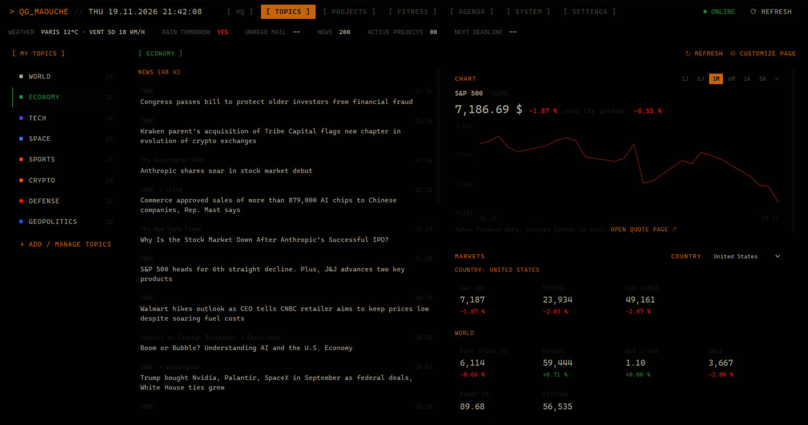
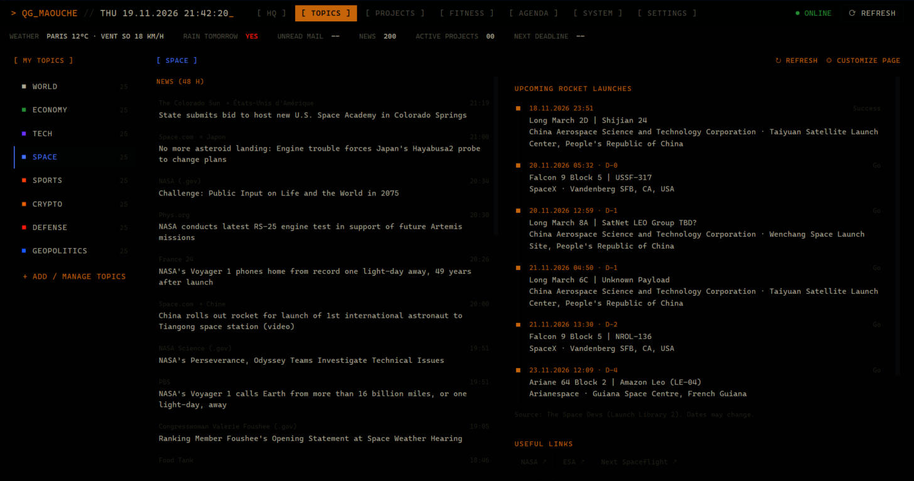
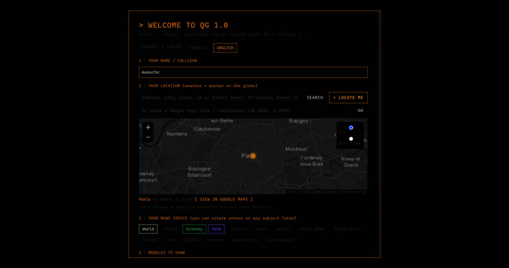

# QG 1.0

🇬🇧 [English version](README.md)

**Ton quartier général personnel sur Windows : l'actu du monde sur un globe 3D, la bourse, la météo, tes mails, tes projets et ton sport, réunis dans une seule application.**

QG 1.0 est un tableau de bord de bureau, gratuit et sans compte, avec une interface sombre façon cockpit. Tu choisis les sujets qui t'intéressent. Chaque sujet a sa propre page, et tout reste sur ton PC.

---

## En bref

- 🌍 **Globe 3D interactif** : chaque actualité est épinglée là où elle se passe, avec une couleur par sujet.
- 🗂️ **Des topics à la carte** : économie, tech, espace, sport, crypto, santé, géopolitique… ou n'importe quel sujet que tu crées toi-même.
- 📈 **Une page par topic** : actus, cours de bourse, graphiques, modules spécialisés, liens utiles et notes.
- ☁️ **Météo** à ta position, avec la pluie prévue pour demain.
- ✉️ **Gmail** : tes mails non lus, avec tes expéditeurs importants en surbrillance.
- ✅ **Projets** : tâches, journal de bord et liste d'achats.
- 🏃 **Sport** : séances, objectifs et courbes de progression.
- 📅 **Agenda** : échéances avec compte à rebours et notes rapides.
- 🖥️ **Système** : analyse de ton PC et de ton réseau.
- 🌐 **En français ou en anglais** : la langue suit celle de Windows et se change dans les réglages.
- 🔒 **Privé par défaut** : données chiffrées sur ton ordinateur, aucun serveur QG, aucune publicité, aucun pistage.

---

## Les topics : une page pour chaque passion

Au premier lancement, tu choisis tes sujets parmi 15 idées prêtes à l'emploi. Chacune arrive déjà configurée avec ses sources d'actualité, ses modules et ses liens. Tu peux aussi créer un topic sur n'importe quel thème : il suffit de taper des mots-clés (par exemple `rugby OR XV de France`) et, si tu veux, d'ajouter tes propres flux RSS.

Chaque page de topic se configure (bouton **⚙ CONFIGURER LA PAGE**) avec les modules de ton choix :

| Module | Ce qu'il affiche |
|---|---|
| **Indices boursiers** | Les indices du pays choisi (CAC 40, S&P 500, DAX, FTSE, Nikkei… 14 pays), plus un aperçu mondial : or, pétrole, EUR/USD, bitcoin |
| **Cours suivis** | Les actions, ETF, cryptos et matières premières de ton choix, avec recherche par nom et graphiques de 1 jour à 5 ans |
| **Lancements spatiaux** | Les prochains décollages de fusées, avec compte à rebours |
| **Séismes** | Les tremblements de terre de magnitude 4,5 et plus sur les dernières 24 h |
| **Qualité de l'air & pollens** | L'indice européen, les particules fines et les pollens à ta position |
| **Top Hacker News** | Les sujets tech du moment |
| **Liens utiles** | Tes sites favoris, ouverts en un clic |
| **Notes** | Un bloc-notes pour chaque sujet |

**Exemple :** tu choisis *Économie*. Ta page affiche les actus économiques, le CAC 40 (ou la bourse de ton pays), ton ETF Monde et tes actions préférées avec leurs graphiques, ainsi que des liens vers Boursorama, Les Echos et l'AMF.

---

## Installation

1. Télécharge **QG-1.0-Setup.exe** dans la section [Releases](../../releases).
2. Lance-le, puis suis l'assistant. L'app s'installe pour ton compte Windows uniquement et ne demande pas de droits administrateur.
3. Un raccourci **QG 1.0** est créé sur le Bureau et dans le menu Démarrer.

Tu préfères ne rien installer ? Télécharge **QG-1.0-portable.zip**, dézippe-le, puis lance `QG-1.0.exe`.

> **Windows SmartScreen** : l'application n'est pas signée par un certificat payant. Windows peut donc afficher « Windows a protégé votre ordinateur ». Clique sur **Informations complémentaires**, puis sur **Exécuter quand même**. Les empreintes SHA-256 des fichiers sont publiées dans `SHA256.txt` pour vérifier leur intégrité.

**Configuration requise :** Windows 10 ou 11, 64 bits, et une connexion Internet pour les actus, la météo et la bourse.

**Désinstallation :** Paramètres Windows → Applications → QG 1.0 → Désinstaller.

---

## Premier lancement

Un assistant d'une minute te demande :

1. ton nom ou indicatif ;
2. ta position, à choisir sur une carte, en cherchant une adresse ou en collant un lien Google Maps ;
3. tes topics ;
4. les modules à afficher.

Tout se modifie ensuite dans **RÉGLAGES**, rangé en six sections : Profil & modules, Position, Actualités & topics, Mails, Données, Sécurité & à propos.

### Connecter Gmail (facultatif)

QG lit tes mails non lus avec un **mot de passe d'application** Google, jamais avec ton mot de passe principal. Pour en créer un : compte Google → Sécurité → Validation en deux étapes (à activer) → Mots de passe des applications. Colle ensuite le code dans RÉGLAGES → MAILS. Le code est stocké chiffré sur ton PC.

---

## Confidentialité et sécurité

- **Aucun compte et aucun serveur QG.** L'application ne contacte que les services nécessaires à ce que tu affiches.
- **Données chiffrées** avec ton compte Windows (DPAPI) : elles sont illisibles sur un autre PC ou par un autre utilisateur.
- **Interface isolée** : aucun script distant n'est exécuté et la page n'a aucun accès au système.
- **Connexions HTTPS uniquement.** Les adresses du réseau local sont refusées pour les flux.
- **Caméra, micro, notifications et pop-ups bloqués.**
- **Sauvegardes automatiques** chiffrées une fois par jour, conservées 30 jours, avec export et import pour changer de PC.

### Services utilisés

| Fonction | Service |
|---|---|
| Météo, qualité de l'air | Open-Meteo |
| Carte de position | Esri (plan et satellite) |
| Recherche d'adresse | Nominatim (OpenStreetMap) |
| Actualités | Google News (recherche par mots-clés) et les flux RSS choisis |
| Bourse | Yahoo Finance (données différées) |
| Lancements spatiaux | The Space Devs – Launch Library 2 |
| Séismes | USGS |
| Tech | Hacker News (Algolia) |
| Mails | Gmail (IMAP sécurisé) |

---

## Avertissements

- Les cours de bourse sont fournis **à titre indicatif**, souvent avec 15 minutes de retard. Ce ne sont **pas des conseils en investissement**.
- Les actualités proviennent de sources tierces. Leur position sur le globe est déduite automatiquement du texte et peut être approximative.
- QG 1.0 est un projet indépendant, sans lien avec Google, Yahoo, la NASA ni les médias cités.

---

## Textes prêts à copier

**Accroche (≈ 80 caractères)**
> Ton QG sur Windows : actus sur globe 3D, bourse, météo, mails et projets.

**Description courte (≈ 250 caractères)**
> QG 1.0 réunit l'actualité du monde sur un globe 3D, des pages personnalisées pour tes passions (économie et bourse, tech, espace, sport…), la météo, tes mails Gmail, tes projets et ton sport. Gratuit, sans compte, données chiffrées sur ton PC.

**Mots-clés**
`tableau de bord` · `dashboard` · `actualités` · `globe 3D` · `bourse` · `ETF` · `météo` · `Gmail` · `productivité` · `Windows` · `vie privée`

---

## Licence

Gratuit pour un usage personnel. © 2026 MAOUCHE Juba — tous droits réservés.
