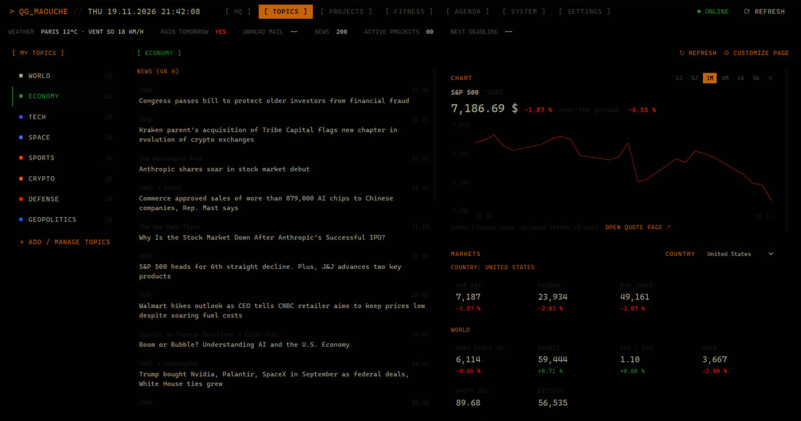
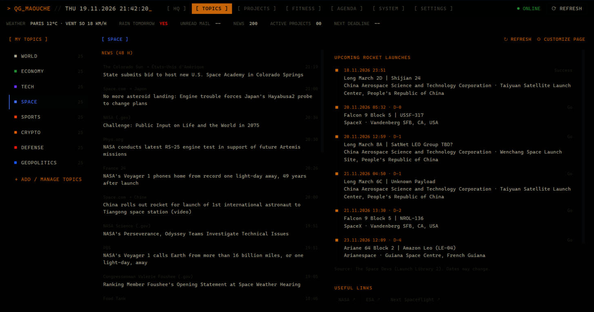
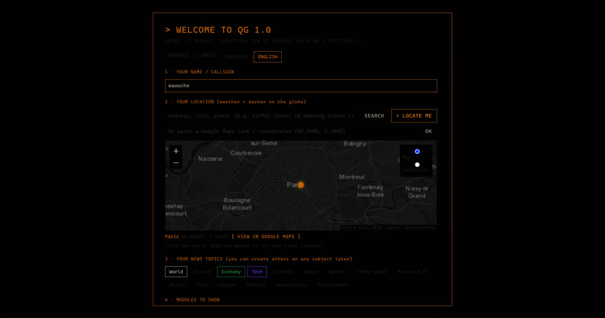

# QG 1.0

🇫🇷 [Version française](README.fr.md)

**Your personal headquarters on Windows: world news on a 3D globe, stock markets, weather, mail, projects and fitness in one app.**

QG ("HQ" in French) is a free desktop dashboard with a dark, cockpit-style interface. You pick the topics you care about, each one gets its own page, and everything stays on your PC.

---

## Highlights

- 🌍 **Interactive 3D globe**: every news story is pinned where it happens, with one colour per topic.
- 🗂️ **Topics your way**: economy, tech, space, sports, crypto, health, geopolitics… or any subject you create yourself.
- 📈 **One page per topic**: news, stock quotes, charts, specialised modules, useful links and notes.
- ☁️ **Weather** at your location, including tomorrow's rain.
- ✉️ **Gmail**: unread mail, with important senders highlighted.
- ✅ **Projects**: tasks, logbook and shopping list.
- 🏃 **Fitness**: sessions, goals and progress charts.
- 📅 **Agenda**: deadlines with countdown and quick notes.
- 🖥️ **System**: PC and network analysis.
- 🌐 **English or French**: follows your Windows language and can be changed in Settings.
- 🔒 **Private by default**: data encrypted on your computer, no QG server, no ads, no tracking.

---

## Topics: one page for each interest

On first launch, you pick your topics from 15 ready-made ideas. Each comes pre-configured with news sources, modules and links. You can also create a topic on any subject: just type keywords (e.g. `rugby OR Six Nations`) and, if you like, add your own RSS feeds.

Each topic page can be customised (**⚙ CUSTOMIZE PAGE**) with the modules you want:

| Module | What it shows |
|---|---|
| **Stock indices** | Indices of the country you choose (S&P 500, CAC 40, DAX, FTSE, Nikkei… 14 countries), plus a world overview: gold, oil, EUR/USD, bitcoin |
| **Watchlist** | Stocks, ETFs, crypto and commodities of your choice, with search by name and charts from 1 day to 5 years |
| **Rocket launches** | Upcoming launches with countdown |
| **Earthquakes** | Magnitude 4.5+ earthquakes in the last 24 h |
| **Air quality & pollen** | European index, fine particles and pollen at your location |
| **Top Hacker News** | Current tech stories |
| **Useful links** | Your favourite sites, one click away |
| **Notes** | A notepad for each topic |

**Example:** you pick *Economy*. Your page shows economic news, the S&P 500 (or your country's market), your world ETF and favourite stocks with their charts, and links to Yahoo Finance, Investing.com and Bloomberg.

---

## Installation

1. Download **QG-1.0-Setup.exe** from the [Releases](../../releases) page.
2. Run it and follow the prompt. The app installs for your Windows account only and needs no administrator rights.
3. A **QG 1.0** shortcut is created on the desktop and in the Start menu.

Prefer not to install anything? Download **QG-1.0-portable.zip**, unzip it and run `QG-1.0.exe`.

> **Windows SmartScreen**: the app is not signed with a paid certificate, so Windows may show "Windows protected your PC". Click **More info**, then **Run anyway**. SHA-256 hashes of the files are published in `SHA256.txt` so you can check their integrity.

**Requirements:** Windows 10 or 11, 64-bit, and an internet connection for news, weather and markets.

**Uninstall:** Windows Settings → Apps → QG 1.0 → Uninstall.

---

## First launch

A one-minute setup asks for:

1. your language (English or French);
2. your name or callsign;
3. your location, picked on a map, by searching an address or by pasting a Google Maps link;
4. your topics;
5. the modules to show.

Everything can be changed later in **SETTINGS**, grouped into six sections: Profile & modules, Location, News & topics, Mail, Data, Security & about.

### Connect Gmail (optional)

QG reads your unread mail with a Google **app password**, never your main password. To create one: Google account → Security → 2-Step Verification (turn it on) → App passwords. Then paste the code in SETTINGS → MAIL. It is stored encrypted on your PC.

---

## Privacy and security

- **No account and no QG server.** The app only contacts the services needed for what you display.
- **Encrypted data** with your Windows account (DPAPI): unreadable on another PC or by another user.
- **Isolated interface**: no remote scripts, and the page has no access to your system.
- **HTTPS only.** Local network addresses are refused for feeds.
- **Camera, microphone, notifications and pop-ups blocked.**
- **Automatic backups**, encrypted, once a day, kept for 30 days, with export and import to move to another PC.

### Services used

| Feature | Service |
|---|---|
| Weather, air quality | Open-Meteo |
| Location map | Esri (map and satellite) |
| Address search | Nominatim (OpenStreetMap) |
| News | Google News (keyword search) and the RSS feeds you choose |
| Markets | Yahoo Finance (delayed data) |
| Rocket launches | The Space Devs – Launch Library 2 |
| Earthquakes | USGS |
| Tech | Hacker News (Algolia) |
| Mail | Gmail (secure IMAP) |

---

## Disclaimers

- Market data is **for information only**, often delayed by 15 minutes. It is **not investment advice**.
- News comes from third-party sources. Its position on the globe is worked out automatically from the text and may be approximate.
- QG 1.0 is an independent project, not affiliated with Google, Yahoo, NASA or any of the media mentioned.

---

## License

Free for personal use. © 2026 MAOUCHE Juba — all rights reserved.
